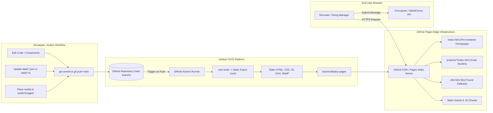

# Comprehensive Frontend-Only Reconstruction Brief
**Target System:** Static Personal Portfolio for GitHub Pages  
**Author / Subject:** Mohamed Abd Elmoniem (Junior Data Analyst)  
**Document Version:** 1.0.0  
**Status:** Architecture Audit & Implementation Specification  
**Audit Date:** October 2026  

---

## 1. Executive Summary

### 1.1 Context and Purpose
This document provides an exhaustive technical audit and an actionable engineering brief for rebuilding Mohamed Abd Elmoniem's full-stack personal portfolio as a 100% static, client-side web application deployable on **GitHub Pages**.

The existing portfolio is built on **Next.js 14 (App Router)** with a hybrid server architecture:
- React Server Components (RSC) fetch dynamic portfolio data at request/revalidation time from local JSON flat-files (`data/*.json`) via Node.js `fs/promises`.
- A custom administrative content management system (`/admin`) provides full CRUD operations, media uploads, and message review.
- A Node.js backend layer manages authentication via JSON Web Tokens (`jose`) and bcrypt password validation, exposes dynamic REST API endpoints (`/api/admin/*`, `/api/contact`), and serves uploaded files directly from local disk via a streaming API route (`/app/uploads/[name]/route.ts`).
- An unused Prisma ORM schema (`prisma/schema.prisma`) and `@prisma/client` dependency exist as technical debt from an earlier PostgreSQL architecture.

### 1.2 Strategic Recommendation: Static Export via Next.js
Rather than abandoning the current codebase to rewrite the site in a completely different framework (such as raw HTML or an unstyled Vite scaffold), the recommended engineering path is to configure the existing **Next.js 14 App Router for Static HTML Export (`output: 'export'`)**:
1. **Preserves 95% of Existing Code & Aesthetics:** Reuses all existing Tailwind styling, layout structures, components, and animations unchanged.
2. **Eliminates Server Run-Time Overhead:** Generates static pre-rendered HTML, CSS, JavaScript, and assets at build time.
3. **Optimized for GitHub Pages:** Eliminates Node.js server dependencies, server actions, dynamic server cookies, and runtime disk operations.
4. **Seamless Content Management via "Data-as-Code":** Migrates JSON disk reads to compile-time TypeScript/JSON imports.
5. **Zero-Backend Third-Party Integrations:** Replaces the Node.js contact form endpoint with a secure, zero-serverless client integration (e.g., Formspree or Web3Forms), and deprecates the in-browser administrative editing dashboard in favor of direct Git-based versioning.

---

## 2. Existing Project Overview

### 2.1 Identity and Professional Positioning
- **Portfolio Owner:** Mohamed Abd Elmoniem (also referenced in settings as Mohamed Shaheen).
- **Target Role:** Junior Data Analyst (open to junior roles, internships, and freelance projects).
- **Academic Background:** Student at Egyptian Russian University, Faculty of Artificial Intelligence (B.Sc. Artificial Intelligence, Class of 2023–2027 expected).
- **Core Domain:** Business Intelligence, Data Cleaning, Data Analysis, Dashboard Development.
- **Key Technologies:** Excel, SQL, Python, Pandas, Power BI, Tableau, Jupyter, MySQL.

### 2.2 System Anatomy & Current Capability Matrix
| Domain | Existing Implementation | Architectural Status |
| :--- | :--- | :--- |
| **Public Portfolio** | Next.js Server Components (`app/page.tsx`) | Server-rendered with ISR (`revalidate = 60`) |
| **Project Detail** | Dynamic Slug Route (`app/projects/[slug]/page.tsx`) | Server-rendered on demand (`revalidate = 60`) |
| **Contact Ingestion** | Next.js Route Handler (`app/api/contact/route.ts`) | Node.js `fs` appends to `data/messages.json` |
| **Admin Portal** | Client App behind Server Gate (`app/admin/page.tsx`) | Cookie session verified by `middleware.ts` & `lib/auth.ts` |
| **Admin REST API** | Dynamic Route Handlers (`app/api/admin/[res]/route.ts`) | Direct JSON mutation via `lib/resources.ts` |
| **Asset Delivery** | Dynamic Streaming Handler (`app/uploads/[name]/route.ts`) | Node.js `fs.readFile` from root `/uploads` directory |
| **Database ORM** | Prisma Schema (`prisma/schema.prisma`) | Unused legacy artifact; replaced by `data/*.json` |

---

## 3. Complete Project Structure

### 3.1 Workspace Directory Tree
The repository contains 10 top-level files and 8 directories:

```text
menam/
├── .gitignore                      # Git exclusion rules (node_modules, .next, .env, uploads/*)
├── README.md                       # High-level developer documentation & setup instructions
├── middleware.ts                   # Next.js Edge/Node middleware protecting /admin routes
├── next-env.d.ts                   # Next.js TypeScript ambient type declarations
├── next.config.js                  # Next.js configuration (remotePatterns for external images)
├── package-lock.json               # Locked dependency graph (npm)
├── package.json                    # Project dependencies, scripts, and package metadata
├── postcss.config.js               # PostCSS configuration for Tailwind CSS and Autoprefixer
├── tailwind.config.js              # Tailwind CSS theme configuration (custom palette & fonts)
├── tsconfig.json                   # TypeScript compiler options (bundler resolution, @/* paths)
├── app/                            # Next.js App Router root
│   ├── error.tsx                   # Client error boundary component
│   ├── globals.css                 # Global CSS rules, Tailwind layers, custom utility classes
│   ├── layout.tsx                  # Root HTML layout, font setup, theme script, SEO metadata
│   ├── loading.tsx                 # Full-page pulse skeleton loader
│   ├── not-found.tsx               # 404 Not Found fallback UI
│   ├── page.tsx                    # Main homepage (Hero, About, Projects, Skills, Exp, Contact)
│   ├── admin/                      # Protected administrative CMS
│   │   ├── Manager.tsx             # Interactive client-side administrative dashboard
│   │   ├── page.tsx                # Server gate checking admin session cookie
│   │   └── login/                  # Admin authentication entry point
│   │       └── page.tsx            # Login credentials form
│   ├── api/                        # Backend REST Route Handlers
│   │   ├── contact/                # Public contact form submission API
│   │   │   └── route.ts            # POST handler validating with Zod, saving to messages.json
│   │   └── admin/                  # Administrative management endpoints
│   │       ├── login/              # POST handler verifying bcrypt password & setting JWT cookie
│   │       │   └── route.ts
│   │       ├── logout/             # POST handler clearing session cookie
│   │       │   └── route.ts
│   │       ├── settings/           # GET/PUT handlers for portfolio settings
│   │       │   └── route.ts
│   │       ├── upload/             # POST handler saving multipart files to /uploads
│   │       │   └── route.ts
│   │       └── [res]/              # Generic resource collection endpoint (CRUD)
│   │           ├── route.ts        # GET (list) and POST (create)
│   │           └── [id]/           # Generic single-resource item endpoint
│   │               └── route.ts    # PUT (update) and DELETE (remove)
│   ├── projects/                   # Case study detail route
│   │   └── [slug]/
│   │       └── page.tsx            # Server-rendered project detail case study
│   └── uploads/                    # Dynamic media streaming route
│       └── [name]/
│           └── route.ts            # GET handler streaming files from /uploads with MIME headers
├── components/                     # Reusable React components
│   ├── ContactForm.tsx             # Interactive contact form with client-side validation
│   ├── Navbar.tsx                  # Sticky responsive header with desktop/mobile navigation
│   └── ThemeToggle.tsx             # Dark/Light mode switcher with localStorage persistence
├── data/                           # Local JSON flat-file storage
│   ├── certifications.json         # Array of certification records (currently empty: [])
│   ├── education.json              # Educational background records
│   ├── experience.json             # Work experience records
│   ├── messages.json               # Contact inquiries saved from public form (currently empty: [])
│   ├── projects.json               # Detailed portfolio project records (4 projects)
│   ├── settings.json               # Personal links, email, CV URL, profile image URL
│   └── skills.json                 # Categorized technical skills (16 records)
├── lib/                            # Server utilities and business logic
│   ├── auth.ts                     # JWT signing and cookie verification via 'jose'
│   ├── data.ts                     # File I/O helpers, type definitions, and default mock data
│   ├── fields.ts                   # Validation schemas and metadata definitions for all CMS models
│   └── resources.ts                # In-memory/JSON-file CRUD query layer mimicking Prisma
├── prisma/                         # Legacy ORM configuration
│   └── schema.prisma               # PostgreSQL schema definition (unused in active code)
├── public/                         # Public static web assets
│   ├── README.txt                  # Notes on static assets
│   ├── favicon.svg                 # Custom SVG brand favicon (data chart motif)
│   └── robots.txt                  # Search engine crawler instructions (disallows /admin)
├── styles/                         # Style documentation directory
│   └── README.txt                  # Notes indicating styles reside in app/globals.css
└── uploads/                        # Server disk storage for uploaded media
    └── .gitkeep                    # Directory preservation placeholder (currently empty)
```

### 3.2 Inventory of Files by Category and Size
| Path | Type | Lines | Size (Bytes) | Role / Content |
| :--- | :--- | :--- | :--- | :--- |
| `package.json` | Config | 30 | 637 | Node project manifest & dependencies |
| `next.config.js` | Config | 2 | 76 | Next.js image domain configuration |
| `tailwind.config.js` | Config | 2 | 273 | Custom Tailwind theme, tokens, & fonts |
| `tsconfig.json` | Config | 39 | 624 | TypeScript compiler configuration |
| `middleware.ts` | Server | 7 | 454 | Admin route session gatekeeper |
| `app/layout.tsx` | UI Layout | 12 | 994 | Root HTML shell, metadata, theme script |
| `app/globals.css` | Styles | 15 | 1,378 | Tailwind layers, component classes, keyframes |
| `app/page.tsx` | UI Page | 58 | 6,669 | Primary homepage with all core sections |
| `app/loading.tsx` | UI Page | 2 | 281 | Pulse loading skeleton screen |
| `app/error.tsx` | UI Page | 5 | 369 | Client error boundary fallback |
| `app/not-found.tsx` | UI Page | 3 | 325 | 404 Not Found fallback screen |
| `app/projects/[slug]/page.tsx` | UI Page | 20 | 1,750 | Project case study dynamic route |
| `components/Navbar.tsx` | Component | 18 | 2,078 | Header, links, mobile menu accordion |
| `components/ContactForm.tsx` | Component | 29 | 2,168 | Interactive form with validation & fetch |
| `components/ThemeToggle.tsx` | Component | 6 | 520 | Theme switch button toggling dark class |
| `lib/data.ts` | Data Layer | 276 | 7,936 | Types, default data, fs read/write helpers |
| `lib/fields.ts` | CMS Logic | 41 | 4,878 | Form field definitions and validation logic |
| `lib/resources.ts` | CMS Logic | 137 | 5,536 | Prisma-like query abstractions for JSON |
| `lib/auth.ts` | Auth Logic | 10 | 468 | JWT generation and cookie parsing |
| `app/admin/page.tsx` | UI Page | 5 | 227 | Server-side admin redirect gate |
| `app/admin/Manager.tsx` | UI Page | 76 | 9,685 | Single-page admin management interface |
| `app/admin/login/page.tsx` | UI Page | 20 | 1,065 | Admin login interface |
| `app/api/contact/route.ts` | API Route | 12 | 679 | Contact form handler saving messages |
| `app/api/admin/login/route.ts` | API Route | 15 | 875 | Bcrypt login verification & session cookie |
| `app/api/admin/logout/route.ts` | API Route | 6 | 158 | Session cookie deletion endpoint |
| `app/api/admin/settings/route.ts`| API Route | 18 | 831 | Settings GET and PUT handlers |
| `app/api/admin/upload/route.ts` | API Route | 18 | 1,097 | File upload handler saving to disk |
| `app/api/admin/[res]/route.ts` | API Route | 19 | 1,154 | Generic resource listing and creation |
| `app/api/admin/[res]/[id]/route.ts`| API Route | 22 | 1,380 | Generic resource update and deletion |
| `app/uploads/[name]/route.ts` | API Route | 12 | 687 | Media file streaming handler |
| `prisma/schema.prisma` | DB Schema | 96 | 2,196 | Legacy PostgreSQL Prisma schema |
| `data/projects.json` | Data Store | 115 | 3,546 | 4 project definitions |
| `data/skills.json` | Data Store | 19 | 1,565 | 16 skill definitions across 4 categories |
| `data/experience.json` | Data Store | 12 | 319 | 1 work experience record |
| `data/education.json` | Data Store | 10 | 224 | 1 university degree record |
| `data/certifications.json` | Data Store | 2 | 4 | Empty array `[]` |
| `data/settings.json` | Data Store | 10 | 280 | Personal contact info and social links |
| `data/messages.json` | Data Store | 2 | 4 | Empty array `[]` |

---

## 4. Technology Stack and Dependencies

### 4.1 Dependency Audit
Inspection of `package.json` reveals the following direct dependencies:

```json
{
  "dependencies": {
    "@prisma/client": "^5.22.0",
    "bcryptjs": "^2.4.3",
    "jose": "^5.4.0",
    "next": "^14.2.0",
    "prisma": "^5.22.0",
    "react": "^18.3.0",
    "react-dom": "^18.3.0",
    "zod": "^3.23.0"
  },
  "devDependencies": {
    "@types/bcryptjs": "^2.4.6",
    "@types/node": "^20",
    "@types/react": "^18",
    "autoprefixer": "^10",
    "postcss": "^8",
    "tailwindcss": "^3.4.0",
    "tsx": "^4.11.0",
    "typescript": "^5.4.0"
  }
}
```

### 4.2 Runtime Role & Disposal Assessment
| Dependency | Version | Current Usage in Codebase | Static Replacement Role | Action in Static Build |
| :--- | :--- | :--- | :--- | :--- |
| `next` | `^14.2.0` | App Router, Server Components, API routes | Static Site Generator (`output: 'export'`) | **Retain** |
| `react` | `^18.3.0` | UI component library | UI component library | **Retain** |
| `react-dom` | `^18.3.0` | DOM rendering layer | DOM rendering layer | **Retain** |
| `tailwindcss` | `^3.4.0` | CSS utility framework | Compiled static CSS | **Retain** |
| `postcss` | `^8` | CSS processor for Tailwind | CSS processor | **Retain** |
| `autoprefixer`| `^10` | Vendor prefixing | Vendor prefixing | **Retain** |
| `typescript` | `^5.4.0` | Static type checking | Static type checking | **Retain** |
| `zod` | `^3.23.0` | Validates payload in `/api/contact/route.ts` | Client-side validation in `ContactForm.tsx` | **Retain (or HTML5 native)** |
| `jose` | `^5.4.0` | JWT signing & cookie verification in `lib/auth.ts` | Not needed (Admin removed) | **Remove** |
| `bcryptjs` | `^2.4.3` | Password hash checking in `/api/admin/login` | Not needed (Admin removed) | **Remove** |
| `@types/bcryptjs` | `^2.4.6` | Type definitions for bcryptjs | Not needed | **Remove** |
| `@prisma/client` | `^5.22.0` | Dead code: imported nowhere in `app/` or `lib/` | Not needed | **Remove** |
| `prisma` | `^5.22.0` | Dev CLI for Prisma ORM | Not needed | **Remove** |
| `tsx` | `^4.11.0` | TypeScript execution runner | Optional local build scripts | **Retain as devDep** |

---

## 5. Page-by-Page and Section-by-Section UI Inventory

### 5.1 Root Document Shell (`app/layout.tsx`)
- **Visual Presentation:** Clean HTML5 wrapper with system font fallbacks, antialiased text, and dark-mode ready classes.
- **Theme Anti-Flicker Script:** Inline JavaScript executed in `<head>` before render:
  ```javascript
  try {
    if (localStorage.theme === 'dark' || (!localStorage.theme && matchMedia('(prefers-color-scheme:dark)').matches)) {
      document.documentElement.classList.add('dark');
    }
  } catch(e) {}
  ```
- **SEO Metadata:**
  - `title`: `"Mohamed Abd Elmoniem | Junior Data Analyst"`
  - `description`: `"Junior Data Analyst turning raw data into insights, dashboards and business decisions."`
  - `openGraph`: Type `"website"`, matching title and description with `"Dashboards, SQL and Python analysis projects."`
  - `favicon`: Inlined data URI SVG with `#2ec4a6` background and chart icon.

### 5.2 Header Navigation (`components/Navbar.tsx`)
- **Structure:** Sticky header (`sticky top-0 z-30`) with blurred translucent background (`bg-slate-50/80 backdrop-blur dark:bg-ink/80`) and subtle lower border (`border-slate-200/70 dark:border-white/10`).
- **Brand Element:** Clickable text link to `#top`: `"Mohamed Abd Elmoniem"` (`font-display text-lg font-semibold`).
- **Desktop Navigation Links:** Five anchor items spaced horizontally (`gap-6 text-sm`):
  1. `About` (`#about`)
  2. `Projects` (`#projects`)
  3. `Skills` (`#skills`)
  4. `Experience` (`#experience`)
  5. `Contact` (`#contact`)
- **Theme Switcher:** Houses `<ThemeToggle />` on the far right.
- **Mobile Menu Interaction:**
  - Hamburger toggle button (`md:hidden`) with animated SVG icon switching between 3 horizontal bars (`M4 7h16M4 12h16M4 17h16`) and an "X" mark (`M6 6l12 12M18 6L6 18`).
  - Dropdown container using CSS Grid transition: `transition-[grid-template-rows] duration-300`, toggling between `grid-rows-[0fr]` and `grid-rows-[1fr]`.
  - Global `Escape` key listener closes the menu automatically.
  - Clicking any link collapses the menu.

### 5.3 Theme Toggle (`components/ThemeToggle.tsx`)
- **Component Anatomy:** Push button (`btn !px-3 !py-1.5`) featuring an SVG sun/burst wireframe icon.
- **Behavior:** Toggles the `"dark"` class on `document.documentElement` and records the current preference in `localStorage.theme` (`"dark"` vs `"light"`).

### 5.4 Homepage (`app/page.tsx`)

#### Section 1: Hero Section
- **Layout:** Responsive 2-column grid (`grid md:grid-cols-[1.2fr_1fr] items-center gap-10 py-16 sm:py-20`).
- **Left Column (Typography & Call to Action):**
  - Animation class: `.rise` (fades in and rises 12px over 0.7s).
  - Main Heading (`<h1>`): `"Hi, I’m Mohamed Abd Elmoniem"` (`text-4xl sm:text-6xl font-bold leading-[1.05]`).
  - Subtitle: `"Junior Data Analyst"` (`font-display text-2xl text-teal mt-3`).
  - Bio pitch: `"I transform raw data into meaningful insights, dashboards, and business decisions."` (`text-lg text-slate-600 dark:text-slate-300 max-w-lg mt-5`).
  - Button Group:
    - `"View My Projects"`: Primary button (`btn btn-primary`) linking to `#projects`.
    - `"Contact Me"`: Secondary button (`btn`) linking to `#contact`.
    - `"Download CV"`: Rendered conditionally if `cfg?.cvUrl` is defined, linking to CV file with HTML `download` attribute.
- **Right Column (Visual Graphic):**
  - If `cfg?.profileImage` is populated: Circular avatar (`h-56 w-56 sm:h-72 sm:w-72 rounded-full border-4 border-teal/40 object-cover`).
  - If `cfg?.profileImage` is empty (current default): Dynamic SVG Bar Chart graphic (`viewBox="0 0 280 200" max-w-xs`):
    - Seven animated bars with heights `[38, 62, 48, 80, 66, 100, 74]`.
    - CSS `.bar` animation growing upward (`scaleY(0)` to `scaleY(1)` over 0.9s cubic bezier) with staggered inline animation delays (`i * 80ms`).
    - Bars 0–4 and 6 filled with Teal (`#2ec4a6`, opacity `0.55`).
    - Bar 5 (the peak bar at height 100) highlighted in Amber (`#f5b94a`, opacity `1.0`).

#### Section 2: About Section (`#about`)
- **Heading:** `<h2>About</h2>` (`text-3xl font-semibold mb-8`).
- **Content:** Four structured paragraphs within `max-w-3xl grid gap-4`:
  1. **Background:** `"I’m a Data Analysis student at the Egyptian Russian University, Faculty of Artificial Intelligence, graduating in 2027."`
  2. **What I do:** `"I clean messy data, analyze it with SQL, Python and Excel, and build Power BI and Tableau dashboards."`
  3. **My approach:** `"Start with the business question, check the data quality, then show only what supports a decision."`
  4. **Career goal:** `"A junior data analyst role or internship where my analysis shapes real business decisions."`

#### Section 3: Featured Projects Section (`#projects`)
- **Heading:** `<h2>Featured projects</h2>`.
- **Filtering Logic:** In the current server code, this section evaluates `getFeaturedProjects()`, which queries `projects.json` for items where `published === true && featured === true`.
- **Grid Layout:** 2-column card grid (`grid sm:grid-cols-2 gap-6`).
- **Card Architecture:**
  - Card wrapper: `card group overflow-hidden !p-0 hover:-translate-y-1 hover:border-teal`.
  - Thumbnail Header: If `p.image` exists, renders `` with `aspect-video object-cover`. If missing (current state in `projects.json`), renders a gradient fallback: `bg-gradient-to-br from-teal/25 to-amber/20`.
  - Body Content:
    - Meta line: Category and Year (`{p.category} · {p.date.getFullYear()}`).
    - Title (`<h3>`): `text-xl font-semibold mt-1`.
    - Summary: `text-sm mt-2`.
    - Tool Chips: Flex container rendering pill badges (`.chip`) for each tool (e.g., `Excel`, `SQL`, `Power BI`).
    - Action link: `"View Project"` in teal with group hover underline effect, linking to `/projects/${p.slug}`.
- **Empty State:** Fallback message rendered if no projects are marked featured.

#### Section 4: Skills Section (`#skills`)
- **Heading:** `<h2>Skills</h2>`.
- **Grouping Logic:** Extracts unique categories from `skills.json`:
  1. `Data Analysis` (Excel, SQL, Python, Pandas, Statistics)
  2. `Business Intelligence` (Power BI, Tableau, Dashboard Development, Data Visualization)
  3. `Programming` (Python, Java, C++)
  4. `Tools` (Git, Jupyter, VS Code, MySQL)
- **Layout:** 2-column card grid (`grid sm:grid-cols-2 gap-5`). Each card displays the category title (`h3 font-semibold`) and a flex-wrap cluster of skill badges (`.chip`).

#### Section 5: Experience & Education Section (`#experience`)
- **Heading 1:** `<h2>Experience</h2>`.
- **Timeline Structure:**
  - Left vertical border: `ol.border-l-2 border-teal/40 pl-6 ml-2`.
  - Bullet node: Absolute positioned dot (`-left-[31px] top-1.5 h-3 w-3 rounded-full bg-teal`).
  - Item details: Role and Company (`h3 font-semibold`), date range (`text-xs text-slate-500`, e.g., `"Jan 2024 to Present"`), and descriptive summary.
  - Active Record: Junior Data Analyst at Freelance / Portfolio Projects.
- **Heading 2:** `<h2>Education</h2>` (`mt-14 mb-6`).
- **Cards Layout:** Cards displaying institution (`h3 font-semibold`), degree title, and attendance years (`"2023 to 2027 (expected)"`).
  - Active Record: Egyptian Russian University, B.Sc. Artificial Intelligence.

#### Section 6: Certifications Section
- **Heading:** `<h2>Certifications</h2>`.
- **Layout:** 2-column card grid (`grid sm:grid-cols-2 gap-5`).
- **Current Behavior:** Since `certifications.json` is `[]`, displays the graceful fallback: `"Certifications will appear here once added in the admin dashboard."` When items exist, renders thumbnail image, title, organization, date, and external certificate verification link.

#### Section 7: Contact Section (`#contact`)
- **Heading:** `<h2>Contact</h2>`.
- **Layout:** Responsive 2-column grid (`grid md:grid-cols-[1.2fr_1fr] gap-8`).
- **Left Column:** The interactive `<ContactForm />`.
- **Right Column:**
  - Copy: `"Open to junior data analyst roles, internships and freelance projects."`
  - Dynamic Social Links: Filtered list of links from `settings.json`:
    - LinkedIn (`https://www.linkedin.com/in/mohamed-abd-elmoniem-21a76b357...`)
    - Email (`mailto:mohamedshaeen680@gmail.com`)
    - GitHub, X (Twitter), Website (rendered if URLs are supplied).

#### Section 8: Footer
- **Visual Presentation:** Centered single-line footer with top hairline border (`border-t border-slate-200 dark:border-white/10 py-6 text-sm`).
- **Content:** `© {currentYear} Mohamed Abd Elmoniem`.

### 5.5 Contact Form Component (`components/ContactForm.tsx`)
- **Inputs:**
  1. `Name` (text input, required)
  2. `Email` (email input, required, regex validated: `/^\S+@\S+\.\S+$/`)
  3. `Subject` (text input, required)
  4. `Message` (textarea, 5 rows, minimum length 5 characters)
- **Current Client Behavior:** Intercepts `onSubmit`, validates inputs into local state `errs`, and fires a `POST` request to `/api/contact`.
- **Status States:**
  - `idle`: Default form state with active submit button (`"Send message"`).
  - `sending`: Button disabled with label `"Sending…"`.
  - `ok`: Form resets, green status message displays: `"Message sent. I'll reply soon."`
  - `err`: Red error message displays: `"Couldn't send your message. Check the fields and try again."`

### 5.6 Project Case Study Detail Page (`app/projects/[slug]/page.tsx`)
- **Routing:** Accessible via `/projects/[slug]` (e.g., `/projects/coffee-shop-sales-dashboard`).
- **Layout:** Single column article container (`max-w-3xl mx-auto px-5 py-12`).
- **Navigation:** Back link to homepage: `<Link href="/#projects">Back to projects</Link>`.
- **Header:**
  - Title (`<h1>`): Large bold project name (`text-3xl font-bold mt-4`).
  - Technologies: Pill/comma list of tools in teal (`text-sm text-teal mt-1`).
- **Structured Case Study Sections:**
  Iterates over an array of 8 defined analytical sections, rendering each section if markdown/text content is present:
  1. `Overview` (from `summary`)
  2. `Business problem` (from `problem`)
  3. `Dataset` (from `datasetInfo`)
  4. `Data cleaning` (from `cleaning`)
  5. `Data analysis` (from `analysis`)
  6. `SQL analysis` (from `sqlAnalysis`)
  7. `Key insights` (from `insights`)
  8. `Business recommendations` (from `recommendations`)
- **External Resource Action Bar:**
  Flex row rendered at the bottom linking to project artifacts if URLs exist:
  - `GitHub` (`p.github`)
  - `Live demo` (`p.demo`)
  - `Dashboard` (`p.dashboard`)
  - `Dataset` (`p.dataset`)

### 5.7 Auxiliary System Pages
- **Loading Skeleton (`app/loading.tsx`):** Pulsing skeleton screen with an animated title block and content rectangle.
- **Error Boundary (`app/error.tsx`):** Centered card notifying that something went wrong, featuring a `"Try again"` retry trigger.
- **404 Not Found (`app/not-found.tsx`):** Centered card notifying that the page does not exist, with a `"Back to home"` link.

---

## 6. Design System and Visual Identity

### 6.1 Color Palette
The portfolio uses a bespoke, high-contrast dark/light color scheme defined in `tailwind.config.js`:

```javascript
colors: {
  ink: "#0a1216",    // Deep obsidian-slate background for dark mode
  teal: "#2ec4a6",   // Primary brand accent (actions, links, charts, active indicators)
  amber: "#f5b94a",  // Highlight accent (peak chart bars, unread badges)
}
```

#### Color Application Matrix
| Semantic Token | Light Mode Value | Dark Mode Value | Usage Context |
| :--- | :--- | :--- | :--- |
| **Page Background** | `bg-slate-50` (`#f8fafc`) | `bg-ink` (`#0a1216`) | Full-viewport body background |
| **Card Surface** | `bg-white` (`#ffffff`) | `bg-white/5` (glassmorphism) | Content cards, form container |
| **Card Border** | `border-slate-200` (`#e2e8f0`)| `border-white/10` | Section outlines, card separators |
| **Text Primary** | `text-slate-900` (`#0f172a`) | `text-white` (`#ffffff`) | Headings, emphasized titles |
| **Text Secondary**| `text-slate-600` (`#475569`) | `text-slate-300` (`#cbd5e1`) | Body text, project summaries |
| **Primary Accent**| `text-teal` (`#2ec4a6`) | `text-teal` (`#2ec4a6`) | Subtitles, links, checkmarks, timeline |
| **Button Primary**| `bg-teal text-ink` | `bg-teal text-ink` | Main CTA buttons |
| **Warning / Peak**| `text-amber` (`#f5b94a`) | `text-amber` (`#f5b94a`) | Highlighted bar chart pillar, badges |

### 6.2 Typography System
Configured in `tailwind.config.js`:
- **Display Font (`font-display`):** `["Segoe UI", "Trebuchet MS", "system-ui", "sans-serif"]`  
  Applied to: Headings (`h1`, `h2`, `h3`), hero title, subtitle, and brand name. Features tight tracking (`tracking-tight`).
- **Body Font (`font-sans`):** `["Segoe UI", "system-ui", "sans-serif"]`  
  Applied to: Body paragraphs, lists, forms, badges, and metadata.

### 6.3 Reusable Component Styles (`app/globals.css`)
- **`.btn`:** `inline-flex items-center justify-center rounded-lg border border-slate-300 px-4 py-2.5 text-sm font-medium transition hover:border-teal hover:text-teal disabled:opacity-50 dark:border-white/15`
- **`.btn-primary`:** `border-teal bg-teal text-ink hover:bg-teal/85 hover:text-ink`
- **`.card`:** `rounded-2xl border border-slate-200 bg-white p-5 shadow-sm transition dark:border-white/10 dark:bg-white/5`
- **`.input`:** `w-full rounded-lg border border-slate-300 bg-transparent px-3 py-2.5 text-sm dark:border-white/15`
- **`.label`:** `mb-1 block text-sm font-medium text-slate-800 dark:text-slate-200`
- **`.err`:** `mt-1 text-xs text-red-500`
- **`.chip`:** `rounded-full border border-slate-200 px-3 py-1 text-xs dark:border-white/15`

### 6.4 Micro-Animations and Transitions
- **Rise Animation (`.rise`):**
  ```css
  @keyframes rise {
    from { opacity: 0; transform: translateY(12px); }
  }
  .rise { animation: rise 0.7s ease both; }
  ```
- **Bar Growth Animation (`.bar`):**
  ```css
  @keyframes grow {
    from { transform: scaleY(0); }
  }
  .bar {
    transform-origin: bottom;
    animation: grow 0.9s cubic-bezier(0.2, 0.8, 0.2, 1) both;
  }
  ```
- **Card Hover Physics:**
  `hover:-translate-y-1 hover:border-teal transition duration-200`
- **Mobile Menu Expansion:**
  `transition-[grid-template-rows] duration-300 ease-out`
- **Accessibility:**
  All keyframe animations are wrapped in `@media (prefers-reduced-motion: no-preference)` to respect user vestibular preferences.

---

## 7. Component and Asset Inventory

### 7.1 Component Categorization
| Component | Path | Current Function | Migration Strategy | Action |
| :--- | :--- | :--- | :--- | :--- |
| `Root` | `app/layout.tsx` | App shell, metadata, theme init | Adapt asset and script paths for GitHub Pages | **Modify** |
| `Navbar` | `components/Navbar.tsx` | Navigation bar & mobile menu | Maintain completely; adjust relative anchor links | **Reuse unchanged** |
| `ThemeToggle` | `components/ThemeToggle.tsx` | Toggles dark mode in localStorage | Retain 100% unchanged | **Reuse unchanged** |
| `ContactForm` | `components/ContactForm.tsx` | Submits to `/api/contact` | Replace endpoint with Formspree/Web3Forms | **Modify** |
| `Home` | `app/page.tsx` | Main portfolio landing page | Import static TS/JSON data instead of `lib/data` | **Modify** |
| `ProjectPage`| `app/projects/[slug]/page.tsx` | Case study page | Add `generateStaticParams()` for pre-rendering | **Modify** |
| `Loading` | `app/loading.tsx` | Pulse skeleton loader | Keep for client route transitions | **Reuse unchanged** |
| `Err` | `app/error.tsx` | Error boundary | Keep for runtime errors | **Reuse unchanged** |
| `NotFound` | `app/not-found.tsx` | 404 page | Generates `out/404.html` for GitHub Pages | **Reuse unchanged** |
| `Manager` | `app/admin/Manager.tsx` | In-browser CMS manager | Deprecate (incompatible with GitHub Pages) | **Remove** |
| `AdminPage` | `app/admin/page.tsx` | Admin session gate | Deprecate | **Remove** |
| `LoginPage` | `app/admin/login/page.tsx` | Admin login form | Deprecate | **Remove** |

### 7.2 Static Asset Inventory
| Asset | Source Location | Target Location | Description & Handling |
| :--- | :--- | :--- | :--- |
| `favicon.svg` | `public/favicon.svg` | `public/favicon.svg` | Brand SVG icon with chart rects. Retain unchanged. |
| `robots.txt` | `public/robots.txt` | `public/robots.txt` | Remove `Disallow: /admin` line since admin is removed. |
| Profile Image | Currently empty in `settings.json` | `public/images/avatar.jpg` | Placeholder or real headshot of Mohamed. |
| CV Document | Currently empty in `settings.json` | `public/documents/cv.pdf` | Resume PDF for download. |
| Project Images | Currently empty strings in `projects.json` | `public/images/projects/*.webp` | Screenshots for project cards and case study banners. |

---

## 8. Current Backend Architecture

### 8.1 Architectural Flow Diagram (Current Full-Stack)

```mermaid
graph TD
    subgraph Browser ["Client Browser"]
        UI_Home["Homepage (app/page.tsx)"]
        UI_Detail["Project Detail (app/projects/[slug])"]
        UI_Form["Contact Form (components/ContactForm)"]
        UI_Admin["Admin Manager (app/admin/Manager)"]
        UI_Login["Admin Login (app/admin/login)"]
    end

    subgraph Server ["Next.js Server Runtime (Node.js)"]
        MW["Middleware (middleware.ts)"]
        AuthModule["Auth Service (lib/auth.ts - jose/bcrypt)"]
        DataModule["Data Layer (lib/data.ts - fs/promises)"]
        ResModule["Resource Abstraction (lib/resources.ts)"]
        
        API_Contact["POST /api/contact"]
        API_Login["POST /api/admin/login"]
        API_Settings["GET/PUT /api/admin/settings"]
        API_Resource["GET/POST /api/admin/[res]"]
        API_Item["PUT/DELETE /api/admin/[res]/[id]"]
        API_Upload["POST /api/admin/upload"]
        API_ServeUpload["GET /uploads/[name]"]
    end

    subgraph Storage ["Server Filesystem Storage"]
        JSON_Projects[("data/projects.json")]
        JSON_Skills[("data/skills.json")]
        JSON_Exp[("data/experience.json")]
        JSON_Edu[("data/education.json")]
        JSON_Certs[("data/certifications.json")]
        JSON_Settings[("data/settings.json")]
        JSON_Messages[("data/messages.json")]
        Disk_Uploads[("uploads/* (Local Disk)")]
    end

    %% Read Operations
    UI_Home -->|Server Render| DataModule
    UI_Detail -->|Server Render| DataModule
    DataModule -->|fs.readFile| JSON_Projects
    DataModule -->|fs.readFile| JSON_Skills
    DataModule -->|fs.readFile| JSON_Exp
    DataModule -->|fs.readFile| JSON_Edu
    DataModule -->|fs.readFile| JSON_Certs
    DataModule -->|fs.readFile| JSON_Settings

    %% Contact Form Flow
    UI_Form -->|fetch POST| API_Contact
    API_Contact -->|writeJson| JSON_Messages

    %% Admin Flow
    UI_Login -->|fetch POST credentials| API_Login
    API_Login -->|Verify Password & Issue JWT| AuthModule
    UI_Admin -->|Check Cookie| MW
    MW -->|Verify Session| AuthModule
    UI_Admin -->|fetch CRUD| API_Resource
    UI_Admin -->|fetch CRUD| API_Item
    UI_Admin -->|fetch Config| API_Settings
    UI_Admin -->|multipart/form-data| API_Upload
    API_Upload -->|fs.writeFile| Disk_Uploads
    API_Resource --> ResModule
    API_Item --> ResModule
    API_Settings --> DataModule
    ResModule -->|writeJson| JSON_Projects

    %% Upload Streaming
    Browser -->|GET /uploads/uuid.jpg| API_ServeUpload
    API_ServeUpload -->|fs.readFile| Disk_Uploads
```



---

## 9. Backend Dependency Audit

Every server-dependent feature has been audited to determine its exact dependencies, data contracts, and static replacement feasibility.

### 9.1 Detailed Audit Breakdown

#### Feature 1: Contact Form Ingestion
- **Frontend Source:** `components/ContactForm.tsx` (lines 6–21).
- **Backend Endpoint:** `app/api/contact/route.ts` (`POST /api/contact`).
- **Backend Logic:** Validates request body with `zod`, reads existing messages from `data/messages.json` using Node.js `fs`, appends a new message record with generated ID, and rewrites the file.
- **Server Dependency:** **Yes.** Requires a persistent server to receive HTTP requests, parse payloads, and persist records.
- **Frontend Replacement:** Integrate a serverless form submission service (such as **Formspree** or **Web3Forms**) or a direct `mailto:` fallback. Formspree/Web3Forms requires only an endpoint URL in the client-side `fetch()`, handles spam filtering, and forwards messages directly to Mohamed's inbox (`mohamedshaeen680@gmail.com`).
- **Limitations:** Free tiers typically limit monthly submissions (e.g., 50/month for Formspree), which is more than adequate for an entry-level personal portfolio.

#### Feature 2: Portfolio Content Data Layer
- **Frontend Source:** `app/page.tsx` (lines 8–15) and `app/projects/[slug]/page.tsx` (lines 6–10).
- **Backend Service:** `lib/data.ts` (`getProjects()`, `getSkills()`, `getExperience()`, etc.) and `lib/resources.ts`.
- **Backend Logic:** Uses `path.join(process.cwd(), "data")` and `fs.readFile` with dynamic ISR cache revalidation (`export const revalidate = 60`).
- **Server Dependency:** **No.** Content changes only when Mohamed updates his portfolio. In a static architecture, data can be imported directly at compile time into the components.
- **Frontend Replacement:** Convert `data/*.json` into strongly typed TypeScript data modules (e.g., `data/projects.ts` or directly import existing JSON files using TypeScript's `resolveJsonModule: true`). Next.js static build pre-renders all HTML at compilation time.
- **Limitations:** Modifying portfolio content requires committing changes to Git and letting GitHub Actions rebuild the site (~1 minute deployment).

#### Feature 3: Dynamic Project Case Study Routing
- **Frontend Source:** `app/projects/[slug]/page.tsx`.
- **Backend Logic:** Evaluates `params.slug` on demand, searches `projects.json` for matches, and returns 404 if not found.
- **Server Dependency:** **No.** The set of projects is finite and known at build time.
- **Frontend Replacement:** Export the `generateStaticParams()` function in `app/projects/[slug]/page.tsx`:
  ```typescript
  export async function generateStaticParams() {
    const projects = await getProjects();
    return projects.map((p) => ({ slug: p.slug }));
  }
  ```
  During `next build`, Next.js will pre-render individual static HTML files for every project slug (e.g., `out/projects/crm-sales-opportunities-dashboard/index.html`).
- **Limitations:** None. Delivers superior page-load performance and instant SEO indexing.

#### Feature 4: Admin Authentication & Session Security
- **Frontend Source:** `app/admin/login/page.tsx`, `middleware.ts`.
- **Backend Endpoint:** `app/api/admin/login/route.ts`, `app/api/admin/logout/route.ts`, `lib/auth.ts`.
- **Backend Logic:** Verifies plain or bcrypt-hashed passwords against `process.env.ADMIN_PASSWORD`, signs an HMAC-SHA256 JWT using `jose` with `process.env.AUTH_SECRET`, and sets an `HttpOnly` session cookie.
- **Server Dependency:** **Yes.** Secrets (`AUTH_SECRET`, `ADMIN_PASSWORD`) cannot be embedded in client-side code without exposing them to anyone inspecting the bundle.
- **Frontend Replacement:** **Remove the in-browser administrative login and dashboard entirely.** On GitHub Pages, portfolio content is managed via Git version control (Data-as-Code). Mohamed edits JSON/TS data files and pushes to GitHub.
- **Limitations:** Loss of a browser-based GUI for editing projects on the live website. However, this eliminates all authentication attack surfaces and server hosting costs.

#### Feature 5: Admin Content Management (CRUD)
- **Frontend Source:** `app/admin/Manager.tsx`.
- **Backend Endpoints:** `app/api/admin/[res]/route.ts`, `app/api/admin/[res]/[id]/route.ts`, `app/api/admin/settings/route.ts`.
- **Backend Logic:** Validates inputs via `lib/fields.ts`, mutates in-memory data structures, writes to `data/*.json` files, and calls `revalidatePath("/")`.
- **Server Dependency:** **Yes.** Browsers running on GitHub Pages cannot write to the web host's filesystem.
- **Frontend Replacement:** Deprecate `Manager.tsx` and the corresponding `/api/admin/*` endpoints. If a CMS interface is required in the future, a static Git-gateway CMS such as **Decap CMS** (formerly Netlify CMS) or **TinaCMS** can be integrated, which writes commits directly to the GitHub repository via the GitHub REST API.
- **Limitations:** None for standard portfolio operations.

#### Feature 6: Media and Document File Uploads
- **Frontend Source:** `Upload` component in `app/admin/Manager.tsx` (lines 8–20).
- **Backend Endpoint:** `app/api/admin/upload/route.ts` and `app/uploads/[name]/route.ts`.
- **Backend Logic:** Receives multipart files, checks size (< 5MB) and MIME type, saves to disk under `uploads/`, and serves them dynamically via stream route.
- **Server Dependency:** **Yes.** GitHub Pages is an immutable file host; it cannot receive file uploads at runtime.
- **Frontend Replacement:** Store static media (project thumbnails, resume PDF, profile image) directly inside the repository under `public/images/` and `public/documents/`. Reference them in the data files as relative or base-path-aware URLs (e.g., `/images/projects/coffee-shop.webp`, `/documents/cv.pdf`).
- **Limitations:** Adding a new project image requires committing the image file to the Git repository.

---

## 10. Frontend-Only Replacement Strategy

### 10.1 Comparative Architectural Summary
```text
┌─────────────────────────────────┐       ┌─────────────────────────────────┐
│     CURRENT FULL-STACK FLOW     │       │    PROPOSED FRONTEND-ONLY FLOW  │
├─────────────────────────────────┤       ├─────────────────────────────────┤
│ • Node.js Server Required       │  ──>  │ • 100% Static HTML / CSS / JS   │
│ • Runtime fs File I/O           │  ──>  │ • Build-Time Static SSG Pre-bake│
│ • /api/contact Route Handler    │  ──>  │ • Serverless Formspree/Web3Forms│
│ • In-Browser Admin & JWT Auth   │  ──>  │ • Data-as-Code via Git Commits  │
│ • Local Disk File Uploads       │  ──>  │ • Static Assets in /public      │
│ • Requires Persistent VPS/Docker│  ──>  │ • Deployed to Free GitHub Pages │
└─────────────────────────────────┘       └─────────────────────────────────┘
```

---

## 11. Original-to-New Feature Mapping

The following comprehensive migration matrix defines the exact transformation for every feature in the repository:

| Original Feature | Current Implementation | Backend Dependency | Frontend-Only Replacement | Files to Reuse | Files to Create or Change | Priority |
| :--- | :--- | :--- | :--- | :--- | :--- | :--- |
| **Homepage Rendering** | Server component reading JSON via Node `fs` | `lib/data.ts` (Node `fs`) | Pre-rendered static HTML at build time (`output: 'export'`) | `app/page.tsx` | Modify `app/page.tsx` to read local data statically | **P1 (Core)** |
| **Case Study Detail Pages** | Dynamic server route `[slug]` | `getProjectBySlug()` via Node `fs` | Pre-render all project pages with `generateStaticParams()` | `app/projects/[slug]/page.tsx` | Add `generateStaticParams` to `app/projects/[slug]/page.tsx` | **P1 (Core)** |
| **Header & Responsive Nav** | Client component with mobile drawer | None | Retain 100% unchanged; adjust anchor links | `components/Navbar.tsx` | Reuse unchanged | **P1 (Core)** |
| **Dark/Light Theme Toggle** | Client component toggling DOM class | None | Retain 100% unchanged; localStorage handles state | `components/ThemeToggle.tsx` | Reuse unchanged | **P1 (Core)** |
| **Animated SVG Bar Chart** | Inline SVG with CSS keyframe delays | None | Retain 100% unchanged in `app/page.tsx` | `app/page.tsx`, `app/globals.css` | Retain styles in `app/globals.css` | **P1 (Core)** |
| **Contact Form Delivery** | Form sends POST to `/api/contact` | `/api/contact/route.ts` & Node `fs` | Client-side fetch to Formspree / Web3Forms or `mailto:` | `components/ContactForm.tsx` | Modify `components/ContactForm.tsx` submission URL | **P1 (Core)** |
| **Portfolio Data Store** | Raw JSON files read at request time | `lib/data.ts`, `lib/resources.ts` | Static TypeScript data modules or direct JSON imports | `data/*.json` | Create `lib/static-data.ts` or refactor `lib/data.ts` | **P1 (Core)** |
| **Static Document Downloads** | Download CV link referencing `cfg.cvUrl` | Dynamic upload URL `/uploads/*` | Relative link to static asset `public/documents/cv.pdf` | `app/page.tsx` | Add CV file to `public/documents/` | **P2 (Asset)**|
| **Project Images & Media** | Dynamic upload URL `/uploads/*` | Dynamic streaming route `/app/uploads/[name]` | Static image files in `public/images/projects/` | None (currently empty) | Add screenshots to `public/images/projects/` | **P2 (Asset)**|
| **Admin Authentication** | Bcrypt password check + JWT session cookie | `jose`, `bcryptjs`, `/api/admin/login`, `middleware.ts` | **Decommission**. Content edited directly via Git. | None | Delete `middleware.ts`, `lib/auth.ts`, `app/admin/login` | **P3 (Cleanup)**|
| **Admin CRUD Dashboard** | Client GUI (`Manager.tsx`) mutating server files | `/api/admin/*`, `lib/resources.ts`, `lib/fields.ts` | **Decommission**. Content edited directly via Git. | None | Delete `app/admin/`, `app/api/admin/`, `lib/resources.ts`| **P3 (Cleanup)**|
| **Database Integration** | Prisma Schema (`schema.prisma`) | PostgreSQL database (unused legacy code) | **Decommission**. Remove `@prisma/client` & `prisma`. | None | Delete `prisma/schema.prisma` | **P3 (Cleanup)**|

---

## 12. Proposed Frontend Architecture

### 12.1 Static Build and Deployment Architecture



### 12.2 Static Configuration Parameters
To enable pure static export in Next.js 14, `next.config.js` must be updated with the following settings:

```javascript
/** @type {import('next').NextConfig} */
const isProd = process.env.NODE_ENV === 'production';
// Replace <REPOSITORY_NAME> with actual repo name if deployed to project page
const repoName = process.env.GITHUB_REPOSITORY ? `/${process.env.GITHUB_REPOSITORY.split('/')[1]}` : '';

const nextConfig = {
  output: 'export',
  distDir: 'out',
  trailingSlash: true,
  images: {
    unoptimized: true, // Required for static export without Node.js image server
  },
  basePath: isProd && repoName ? repoName : '',
  assetPrefix: isProd && repoName ? repoName : '',
};

module.exports = nextConfig;
```

---

## 13. Proposed File and Folder Structure

Following the decommission of server routes and the admin portal, the clean frontend-only repository will be structured as follows:

```text
menam/
├── .github/
│   └── workflows/
│       └── deploy.yml              # Automated GitHub Actions build & deploy workflow
├── .gitignore                      # Updated gitignore (includes out/, removes uploads)
├── README.md                       # Updated documentation with static deployment instructions
├── next-env.d.ts
├── next.config.js                  # Configured with output: 'export' & unoptimized images
├── package.json                    # Trimmed of bcrypt, jose, prisma dependencies
├── postcss.config.js
├── tailwind.config.js
├── tsconfig.json
├── app/
│   ├── error.tsx                   # Client error boundary
│   ├── globals.css                 # Preserved design system & animations
│   ├── layout.tsx                  # Root layout with base-path friendly metadata
│   ├── loading.tsx                 # Preserved loading skeleton
│   ├── not-found.tsx               # Rendered as out/404.html for GitHub Pages
│   ├── page.tsx                    # Static homepage
│   └── projects/
│       └── [slug]/
│           └── page.tsx            # Static case study page with generateStaticParams()
├── components/
│   ├── ContactForm.tsx             # Updated with serverless endpoint integration
│   ├── Navbar.tsx                  # Preserved responsive navigation
│   └── ThemeToggle.tsx             # Preserved theme switcher
├── data/                           # Canonical static portfolio data
│   ├── certifications.json
│   ├── education.json
│   ├── experience.json
│   ├── projects.json
│   ├── settings.json
│   └── skills.json
├── lib/
│   ├── data.ts                     # Refactored purely static data getters (no fs)
│   └── types.ts                    # Extracted TypeScript type definitions
└── public/
    ├── favicon.svg                 # Brand icon
    ├── robots.txt                  # Public crawler rules
    ├── documents/
    │   └── cv.pdf                  # Mohamed's downloadable resume
    └── images/
        ├── avatar.jpg              # Profile photograph
        └── projects/               # Case study preview graphics
            ├── coffee-shop.webp
            ├── crm-dashboard.webp
            ├── railway.webp
            └── home-price.webp
```

---

## 14. File Reuse, Modification, Creation, and Removal Plan

### 14.1 Files to Reuse Unchanged
- `components/ThemeToggle.tsx`: Completely client-side, toggles DOM classes, persists in `localStorage`.
- `components/Navbar.tsx`: Uses React client state for the mobile drawer; no server dependencies.
- `app/loading.tsx`: Purely visual skeleton markup.
- `app/error.tsx`: Standard React client error boundary.
- `public/favicon.svg`: Brand SVG asset.
- `postcss.config.js`: Standard PostCSS configuration.
- `tailwind.config.js`: Custom color palette and font definitions.

### 14.2 Files to Modify
- `package.json`:
  - Remove backend dependencies: `@prisma/client`, `prisma`, `bcryptjs`, `@types/bcryptjs`, `jose`.
  - Retain `next`, `react`, `react-dom`, `tailwindcss`, `postcss`, `autoprefixer`, `typescript`, `@types/node`, `@types/react`, `zod`.
  - Add deployment helper scripts if needed.
- `next.config.js`:
  - Add `output: 'export'`.
  - Add `images: { unoptimized: true }`.
  - Add conditional `basePath` and `assetPrefix` based on repository environment.
  - Add `trailingSlash: true`.
- `lib/data.ts`:
  - Remove Node.js imports: `import { randomUUID } from "crypto"`, `import { promises as fs } from "fs"`, `import path from "path"`.
  - Import JSON files directly as ES modules (`import projectsData from "@/data/projects.json"`).
  - Update getters (`getProjects()`, `getSkills()`, etc.) to synchronous or resolved promises returning local data.
- `app/page.tsx`:
  - Update data calls to use the refactored static data layer.
  - Ensure image URLs account for static asset locations.
- `app/projects/[slug]/page.tsx`:
  - Add `export async function generateStaticParams()` to pre-render all project routes at compile time.
  - Update data lookup to use the static data helper.
- `components/ContactForm.tsx`:
  - Replace the internal `fetch("/api/contact")` call with an external service endpoint (e.g., `https://formspree.io/f/{FORM_ID}` or `https://api.web3forms.com/submit`).
- `app/layout.tsx`:
  - Ensure links, icons, and theme scripts correctly resolve relative to the base path.
- `public/robots.txt`:
  - Remove `Disallow: /admin` line since `/admin` no longer exists.
- `.gitignore`:
  - Add `out/`.
  - Remove `uploads/*` and `.env` references if no secrets remain.

### 14.3 Files to Create
- `.github/workflows/deploy.yml`: Automated CI/CD workflow to build and deploy to GitHub Pages on every push to `main`.
- `lib/types.ts`: Clean separation of data models (`ProjectRecord`, `SkillRecord`, `ExperienceRecord`, etc.).
- Static media files:
  - `public/documents/cv.pdf`: Downloadable CV file.
  - `public/images/projects/*`: Screenshots for each case study.

### 14.4 Files to Remove (Decommission)
- `middleware.ts`: Server-only edge routing logic.
- `prisma/schema.prisma` and `prisma/`: Dead code; unneeded ORM.
- `lib/auth.ts`: Server-only JWT session handling.
- `lib/fields.ts`: CMS form schema and field validation.
- `lib/resources.ts`: Mock Prisma CRUD query layer.
- `app/admin/` (entire directory: `Manager.tsx`, `page.tsx`, `login/page.tsx`): Server-dependent CMS.
- `app/api/` (entire directory: `/contact`, `/admin/*`): Node.js API route handlers.
- `app/uploads/` (entire directory): Dynamic streaming route handler.
- `uploads/` (root folder): Server disk storage.
- `data/messages.json`: Contact messages are delivered to email directly via serverless form handler.

---

## 15. GitHub Pages Compatibility Audit

### 15.1 Static Output Directory
Next.js outputs static export files to the `out/` directory when `output: 'export'` is set in `next.config.js`. GitHub Pages must be configured to deploy the contents of `out/`.

### 15.2 Base Path & Subpath Resolution
When hosted on GitHub Pages under a project repository URL:
`https://<USERNAME>.github.io/<REPOSITORY>/`
All asset references, JavaScript bundles, CSS stylesheets, and client-side links will fail with HTTP 404 if they use root-relative paths like `/globals.css` or `/projects/slug`.
- **Solution:** Configure `basePath` and `assetPrefix` in `next.config.js`.
- In Next.js, `<Link href="/projects/slug">` automatically prepends the configured `basePath`.
- Hardcoded asset URLs in HTML or data (e.g., `/images/avatar.jpg`) must either use relative paths or dynamically prepend `process.env.NEXT_PUBLIC_BASE_PATH`.

### 15.3 Trailing Slashes & Direct Route Refreshing
GitHub Pages static file servers look for:
- `/projects/slug/index.html` when requesting `/projects/slug/`
- If trailing slash is false, Next.js generates `/projects/slug.html`. On some GitHub Pages configurations, refreshing `/projects/slug` directly can trigger a 404 error.
- **Solution:** Set `trailingSlash: true` in `next.config.js`. This forces Next.js to export directory-based index files (`out/projects/<slug>/index.html`), ensuring direct browser navigation and page reloads work seamlessly.

### 15.4 Client-Side Routing and 404 Fallback
Next.js statically generates `out/404.html` from `app/not-found.tsx`. GitHub Pages natively serves `404.html` whenever an unknown URL path is requested, providing a seamless branded fallback experience.

### 15.5 Next.js Image Optimization
Next.js's default `<Image />` component relies on a Node.js server image optimization API (`/_next/image`). Running `next build` with `output: 'export'` will throw an error if unoptimized images are not explicitly configured.
- **Solution:** Set `images: { unoptimized: true }` in `next.config.js`. Standard HTML `` elements (which the existing codebase already uses) continue to function without alteration.

### 15.6 GitHub Actions Deployment Workflow
The repository requires an automated deployment configuration. The proposed workflow file (`.github/workflows/deploy.yml`) is:

```yaml
name: Deploy Static Portfolio to GitHub Pages

on:
  push:
    branches: ["main"]
  workflow_dispatch:

permissions:
  contents: read
  pages: write
  id-token: write

concurrency:
  group: "pages"
  cancel-in-progress: false

jobs:
  build:
    runs-on: ubuntu-latest
    steps:
      - name: Checkout Repository
        uses: actions/checkout@v4

      - name: Setup Node.js
        uses: actions/setup-node@v4
        with:
          node-version: 20
          cache: "npm"

      - name: Install Dependencies
        run: npm ci

      - name: Build Static Export
        run: npm run build
        env:
          NEXT_PUBLIC_BASE_PATH: ${{ github.event.repository.name != format('{0}.github.io', github.repository_owner) && format('/{0}', github.event.repository.name) || '' }}

      - name: Upload GitHub Pages Artifact
        uses: actions/upload-pages-artifact@v3
        with:
          path: ./out

  deploy:
    environment:
      name: github-pages
      url: ${{ steps.deployment.outputs.page_url }}
    runs-on: ubuntu-latest
    needs: build
    steps:
      - name: Deploy to GitHub Pages
        id: deployment
        uses: actions/deploy-pages@v4
```

---

## 16. Security and Secrets Audit

### 16.1 Elimination of Attack Surface
The existing full-stack portfolio introduces several critical security vulnerabilities if deployed publicly without proper server hardening:
1. **Plaintext / Weak Password Comparison:** In `app/api/admin/login/route.ts` (line 7), if `expectedPassword` is not a bcrypt hash, it falls back to a plain string comparison (`password === expectedPassword`), vulnerable to timing attacks.
2. **Exposed Server Secret:** `lib/auth.ts` requires `process.env.AUTH_SECRET`. If misconfigured or pushed to GitHub, attackers can forge JWT admin tokens.
3. **Local File Inclusion / Denial of Service in Uploads:** `app/api/admin/upload/route.ts` writes directly to the local server disk with no virus scanning, quarantine, or disk quota limits.
4. **Denial of Service via Contact Form:** `app/api/contact/route.ts` appends directly to `data/messages.json` with no rate limiting, CAPTCHA, or IP throttling.

### 16.2 Security Gains in Frontend-Only Architecture
1. **Zero Secrets in Repository:** `AUTH_SECRET`, `ADMIN_PASSWORD`, and `ADMIN_EMAIL` are completely removed. No `.env` secrets exist or risk leaking into client bundles.
2. **Immunity to Server Exploits:** With no Node.js server, SQL injection, remote code execution, server memory leaks, and disk exhaustion attacks are impossible.
3. **Third-Party Spam Protection:** Delegating contact form submission to Formspree or Web3Forms provides enterprise-grade bot protection (honeypot fields, rate limiting, and reCAPTCHA) with zero maintenance.

### 16.3 Client Secret Hygiene
- If using Web3Forms or Formspree, the public form access key (e.g., `NEXT_PUBLIC_FORM_KEY`) is meant to be client-accessible and restricted by origin domain (e.g., `https://<username>.github.io`).
- No private API keys or personal credentials will be embedded in client-side code.

---

## 17. Implementation Phases and Task Checklist

The future reconstruction must be executed in seven sequential, testable phases:

### Phase 1: Project Setup and Dependency Pruning
- [ ] Task 1.1: Remove dead dependencies (`@prisma/client`, `prisma`, `bcryptjs`, `@types/bcryptjs`, `jose`) from `package.json`.
- [ ] Task 1.2: Remove unused files (`prisma/schema.prisma`, `middleware.ts`, `lib/auth.ts`, `lib/fields.ts`, `lib/resources.ts`).
- [ ] Task 1.3: Update `next.config.js` with `output: 'export'`, `trailingSlash: true`, `images: { unoptimized: true }`, and dynamic base path logic.
- [ ] Task 1.4: Update `.gitignore` to include `out/` and clean up legacy entries.
- [ ] Task 1.5: Create `.github/workflows/deploy.yml` for automated GitHub Pages CI/CD.
- *Dependencies:* None.  
- *Risks:* Build failure if deleted files are still imported elsewhere.  
- *Completion Criteria:* `npm install` runs cleanly without backend packages; `next.config.js` is valid.

### Phase 2: Static Data Layer Refactoring
- [ ] Task 2.1: Create `lib/types.ts` containing TypeScript definitions for `ProjectRecord`, `SkillRecord`, `ExperienceRecord`, `EducationRecord`, `CertificationRecord`, and `SettingsRecord`.
- [ ] Task 2.2: Refactor `lib/data.ts` to import `data/*.json` statically instead of calling `fs.readFile` / `process.cwd()`.
- [ ] Task 2.3: Convert getter functions (`getProjects()`, `getFeaturedProjects()`, `getSkills()`, etc.) into pure synchronous or resolved-promise functions that operate in-memory.
- [ ] Task 2.4: Ensure dates are parsed as standard ISO strings/Date objects for component consumption.
- *Dependencies:* Phase 1.  
- *Risks:* TypeScript compilation errors on type mismatch between JSON and component props.  
- *Completion Criteria:* `lib/data.ts` compiles without any Node.js core library imports (`fs`, `path`, `crypto`).

### Phase 3: Route & Component Static Adaptation
- [ ] Task 3.1: Delete the administrative UI directory (`app/admin/`) and all backend API routes (`app/api/`, `app/uploads/`).
- [ ] Task 3.2: Update `app/projects/[slug]/page.tsx` to export `generateStaticParams()` reading all published slugs from static data.
- [ ] Task 3.3: Verify `app/page.tsx` renders correctly with the refactored data getters.
- [ ] Task 3.4: Verify `app/not-found.tsx` generates valid `out/404.html`.
- [ ] Task 3.5: Update `public/robots.txt` to remove administrative disallow directives.
- *Dependencies:* Phase 2.  
- *Risks:* Unresolved dynamic routes causing export failure during `next build`.  
- *Completion Criteria:* `npm run build` generates a complete static `out/` directory containing `index.html`, `404.html`, and `projects/*/index.html`.

### Phase 4: Serverless Contact Form Integration
- [ ] Task 4.1: Modify `components/ContactForm.tsx` to submit form data to a serverless provider (Formspree or Web3Forms endpoint).
- [ ] Task 4.2: Add an anti-spam honeypot input field (`display: none`).
- [ ] Task 4.3: Preserve existing client-side validation logic (name, valid email regex, subject, message length >= 5).
- [ ] Task 4.4: Preserve UI states (`idle`, `sending`, `ok`, `err`) and feedback messaging.
- [ ] Task 4.5: Provide a clear `mailto:` link fallback in case of network or provider downtime.
- *Dependencies:* Phase 3.  
- *Risks:* Form submissions blocked by third-party CORS if endpoint is incorrectly configured.  
- *Completion Criteria:* Submitting the form successfully dispatches the payload to the external service and updates the UI state to `"Message sent."`

### Phase 5: Asset Consolidation and Base Path Verification
- [ ] Task 5.1: Structure `public/` directories for media: `public/images/projects/` and `public/documents/`.
- [ ] Task 5.2: Place Mohamed's resume PDF into `public/documents/cv.pdf` and update `data/settings.json` `cvUrl`.
- [ ] Task 5.3: Place project screenshots into `public/images/projects/` and update `image` fields in `data/projects.json`.
- [ ] Task 5.4: Ensure all image tags, anchor links, and script tags handle `basePath` correctly for GitHub Pages subpaths.
- *Dependencies:* Phase 3, Phase 4.  
- *Risks:* Broken images or 404 assets when viewing the site on `username.github.io/repo-name/`.  
- *Completion Criteria:* All images, SVGs, and links render properly both locally (`/`) and with a simulated repository subpath (`/portfolio/`).

### Phase 6: Visual Polish, Dark Mode, and Responsive Testing
- [ ] Task 6.1: Verify dark/light theme switching operates without flashing on page load.
- [ ] Task 6.2: Verify the SVG animated bar chart renders with proper CSS staggered delays when no avatar image is supplied.
- [ ] Task 6.3: Verify mobile menu drawer opens, collapses on link click, and closes on `Escape` key press across phone viewports (< 640px).
- [ ] Task 6.4: Test case study pages across tablet and desktop viewports.
- *Dependencies:* Phase 5.  
- *Risks:* CSS layout shifts or overflow on smaller viewports.  
- *Completion Criteria:* Zero console errors, zero layout overflow, 100% responsive design adherence across mobile, tablet, and desktop viewports.

### Phase 7: Production Build, GitHub Actions Verification, and Launch
- [ ] Task 7.1: Execute `npm run build` locally and verify the static export in `out/`.
- [ ] Task 7.2: Test the static build using a zero-configuration static file server (`npx serve out`).
- [ ] Task 7.3: Commit and push changes to GitHub.
- [ ] Task 7.4: Enable GitHub Pages in repository settings (Source: GitHub Actions).
- [ ] Task 7.5: Monitor GitHub Actions pipeline run and verify live deployment on GitHub Pages URL.
- *Dependencies:* Phases 1–6.  
- *Risks:* GitHub Actions permissions error (`pages: write` missing).  
- *Completion Criteria:* Portfolio is live, functional, secure, and lightning-fast on `https://<username>.github.io/<repo>/`.

---

## 18. Testing and Acceptance Criteria

### 18.1 Static Build Verification
- Running `npm run build` must complete with exit code `0`.
- The output directory `out/` must be populated with:
  - `out/index.html` (Homepage)
  - `out/404.html` (Not Found page)
  - `out/projects/crm-sales-opportunities-dashboard/index.html`
  - `out/projects/coffee-shop-sales-dashboard/index.html`
  - `out/projects/uk-railway-analytics/index.html`
  - `out/projects/home-price-analysis/index.html`
  - `out/_next/static/` (Compiled JS and CSS bundles)
- No server runtime warnings or dynamic server-side bailout messages during build.

### 18.2 Functional Acceptance Matrix
| Test Case | Interaction / Trigger | Expected Outcome | Status |
| :--- | :--- | :--- | :--- |
| **TC-01: Theme Toggle** | Click sun/moon icon | Document toggles `.dark`; `localStorage.theme` updates; background changes from `#f8fafc` to `#0a1216`. | Pass / Required |
| **TC-02: Mobile Nav** | Click hamburger button on `< 768px` | Menu expands smoothly via CSS grid; clicking a link or pressing Escape closes menu. | Pass / Required |
| **TC-03: Bar Chart** | Load page without profile image | SVG renders 7 vertical bars; bars animate upward; 6th bar is highlighted in Amber (`#f5b94a`). | Pass / Required |
| **TC-04: Project Link** | Click "View Project" on project card | Client transitions smoothly to `/projects/<slug>/`; case study details render fully. | Pass / Required |
| **TC-05: Direct URL** | Navigate directly to `/projects/<slug>/` in address bar | Page loads directly without 404 error; metadata title displays `<Project> \| Mohamed Abd Elmoniem`. | Pass / Required |
| **TC-06: 404 Route** | Navigate to `/non-existent-page` | Custom 404 screen renders with "Page not found" and "Back to home" button. | Pass / Required |
| **TC-07: Contact Form** | Submit form with empty fields | Client-side validation errors display under each field; no network request fired. | Pass / Required |
| **TC-08: Form Success** | Submit form with valid details | Button shows "Sending…"; payload dispatched to service; form resets; green success confirmation appears. | Pass / Required |
| **TC-09: CV Download** | Click "Download CV" in Hero | Browser downloads `cv.pdf` directly without routing error. | Pass / Required |
| **TC-10: Subpath Test** | Serve build from subpath `/portfolio/` | All CSS, JS, fonts, and assets load without 404 errors. | Pass / Required |

---

## 19. Known Limitations and Risks

### 19.1 In-Browser Editing Deprecation
- **Limitation:** The portfolio owner will no longer have an `/admin` URL to log in and type new project descriptions via a web form on the live site.
- **Mitigation & Impact:** For a personal portfolio, projects and skills change infrequently (weekly or monthly). Managing content via Git (`data/projects.json`) is the industry standard for senior engineers. It provides free version history, rollbacks, branch previews, and eliminates database/authentication vulnerabilities.

### 19.2 Third-Party Form Service Dependency
- **Limitation:** Form delivery depends on an external service (Formspree or Web3Forms). If the service is down or monthly free quota is exceeded, form submissions could fail.
- **Mitigation:** The contact section prominently includes direct contact links (`mailto:mohamedshaeen680@gmail.com` and LinkedIn profile), ensuring prospective employers and clients always have an instant direct communication channel.

### 19.3 Static File Pre-Rendering for New Projects
- **Limitation:** Adding a new project requires running a new build (`npm run build` via GitHub Actions).
- **Mitigation:** GitHub Actions builds and deploys Next.js static exports in under 60 seconds automatically on every `git push`.

---

## 20. Final Recommended Implementation Plan

When ready to begin reconstruction, follow this exact execution sequence:

1. **Retain Next.js 14 as the Core Framework:** Do not switch to Vite, Astro, or vanilla HTML. Next.js 14 static export preserves all existing code, Tailwind configurations, React components, and styling with zero visual degradation.
2. **Execute File Deletion & Pruning First:** Strip out `middleware.ts`, `prisma/`, `lib/auth.ts`, `lib/fields.ts`, `lib/resources.ts`, `app/admin/`, and `app/api/`. Uninstall `@prisma/client`, `prisma`, `bcryptjs`, and `jose`.
3. **Refactor `lib/data.ts` to Static ES Modules:** Import `data/*.json` directly into `lib/data.ts`.
4. **Configure `next.config.js` for Static Export:** Add `output: 'export'`, `trailingSlash: true`, `images: { unoptimized: true }`, and repository base path logic.
5. **Add `generateStaticParams` to `app/projects/[slug]/page.tsx`:** Enable pre-rendering for all project slugs.
6. **Swap `/api/contact` in `components/ContactForm.tsx` for Formspree / Web3Forms:** Maintain existing validation and state management.
7. **Commit GitHub Actions Workflow (`.github/workflows/deploy.yml`):** Push to GitHub and activate GitHub Pages in repository settings.

---
*End of Brief. Document prepared for engineering execution.*
